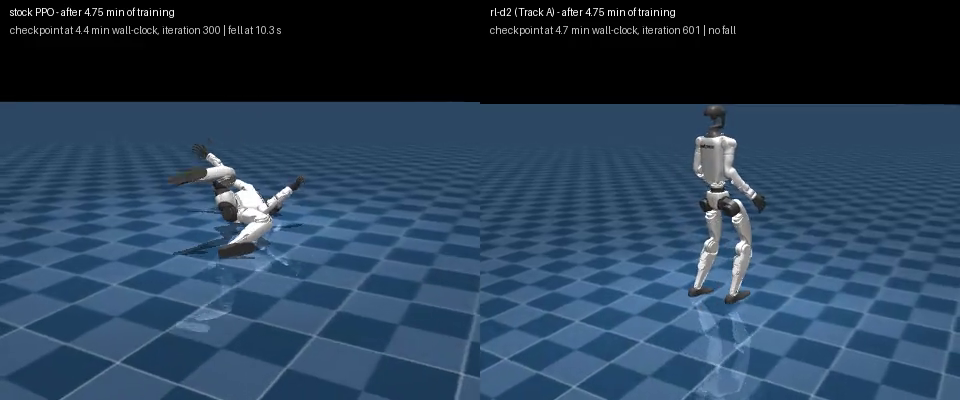

# Babysteps

**How fast can one GPU teach a humanoid to walk robustly?**

Babysteps turns "time-to-walk" into a benchmark with a frozen finish line, then sets
records against it. The robot is the 29-DoF G1 humanoid in
[mjlab](https://github.com/mujocolab/mjlab) (MuJoCo Warp); the baseline is mjlab's stock
velocity-tracking PPO recipe ([rsl_rl](https://github.com/leggedrobotics/rsl_rl)), run
exactly as shipped. Every number below is on one RTX 4090 (Ryzen 9 7950X host), from a
cold start with compilation caches wiped, over 5 seeds, and comes from [`LEDGER.md`](LEDGER.md).

| | time-to-bar, median [IQR] | per seed (min) | iterations to bar | s / iteration | GPU util (NVML) |
|---|---|---|---|---|---|
| stock mjlab PPO (T0) | **13.26 min** [12.77, 15.78] | 18.05, 13.26, 12.77, 15.78, 12.77 | 1,432 | 0.528 | 73.1% |
| Babysteps Track A (PPO) | **4.69 min** [4.69, 4.80] | 4.69, 5.20, 4.69, 4.68, 4.80 | 601 | 0.399 | 99.99% |
| speedup | **2.83x** (3.14x excluding startup/compile) | | 2.38x | 1.32x | |

All 10 runs pass every check. At the first passing checkpoint (medians), stock vs Track A:
linear error 0.098 vs 0.097 m/s, yaw error 0.113 vs 0.106 rad/s, fall-free 100% vs 100%,
push survival 100% vs 99.2% (1 of 128 pushes), sim-to-sim 16/16 vs 16/16.
The 3x target was not reached; this is the best result that passed the rules.


*Same wall-clock budget, same seed, same command schedule and push: stock (left, its
checkpoint at 4.4 min) falls after the push; Track A (right) keeps walking.
[video](videos/minute_4p75.mp4)*

## The bar

A checkpoint "walks robustly" when, evaluated offline with fixed seeds, it
1. tracks 24 held-out velocity commands (8 structured, 16 drawn before any training)
   within **0.11 m/s** linear and **0.12 rad/s** yaw-rate error,
2. completes **>= 98%** of 20 s episodes without falling under randomized friction,
   center-of-mass offset and encoder bias,
3. survives **>= 90%** of **1.25 m/s** horizontal pushes from 8 directions,
4. still walks when the same weights drive **CPU MuJoCo** instead of MuJoCo Warp
   (>= 14 of 16 episodes fall-free with linear error <= 0.165 m/s).

Thresholds were set by a rule written before calibration finished (1.25x the worst of
three stock reference policies, separate seeds), then frozen with a sha256 before any
optimization: [`RULES.md`](RULES.md), [`DECISIONS.md`](DECISIONS.md) D6 and D9.
The judge never imports training code: every recipe writes a portable checkpoint
(normalizer + MLP weights) every 30 s of wall time, and time-to-bar is the timestamp of
the first one that passes.

## Where the time went

Nsight Systems, NVTX ranges, 10 steady-state iterations, same host and procedure for both
([`scripts/profile_pair.sh`](scripts/profile_pair.sh)). Stock phases come from NVTX
(host) and kernel attribution (GPU); Track A runs as two CUDA graphs, so its phases
were timed as separately captured graphs ([`scripts/bench_components.py`](scripts/bench_components.py)).

| per iteration | stock host ms | stock GPU ms | Track A GPU ms |
|---|---|---|---|
| simulation (MuJoCo Warp step, forward, sensors) | 24.7 | 236.0 | 243.0 |
| env managers (rewards, obs, resets, commands, events) | **359.8** | 30.1 | 37.7 |
| policy inference | 14.9 | 4.1 | 3.4 |
| rollout storage | 11.4 | 1.7 | 1.7 |
| GAE | 2.2 | 0.4 | 0.4 |
| update forward + loss | 30.4 | 9.1 | 27.5 (8 epochs, symmetry, bf16) |
| backprop | 27.2 | 39.8 (autograd thread) | 42.7 |
| optimizer step + grad clip | 11.5 | 2.4 | 10.3 |
| host<->device: sync API calls / kernel launches | **2,278 / 27,898** | | **2 / 5 (+2 graph launches)** |
| kernel coverage (time any kernel runs / wall) | **57.6%** | | **99.9%** |

The stock loop is host-bound: mjlab's manager-based env issues ~1,100 small kernels and
~95 synchronizations per control step. Physics is already a CUDA graph and is the real floor.

## What changed (Track A)

Systems (no change to the MDP):
* **The whole env step in one CUDA graph, without rewriting the task.** The env runs N+1
  worlds; reset / resample / push indices come from `torch.nonzero_static(..., fill_value=N)`,
  so mjlab's own `reset(env_ids)` code runs with static shapes and padded entries hit a
  dummy world the learner never sees. MuJoCo Warp kernels are recorded into the PyTorch
  graph through Warp's external capture. A 24-step rollout (policy, physics, rewards,
  resets, storage) plus GAE is one graph launch.
* **PPO update as one graph:** rsl_rl's update with the same math, but the KL-adaptive
  learning rate lives on the device and feeds a capturable fused Adam; bf16 autocast.
* Stats read back through pinned memory and CUDA events one iteration late: **1 sync per
  iteration** instead of ~2,300.
* Checks: post-reset observations bitwise identical to stock over 203 matched resets;
  graphed update matches rsl_rl's to 1.6e-7 ([`tests/`](tests)).

Recipe (still PPO, same task, same evaluation): KL target 0.01 -> 0.02, left-right
symmetry augmentation of the actor loss (mirror map verified against physics),
8 epochs instead of 5, yaw-rate tracking reward weight 2 -> 4.

{{ABLATION_TABLE}}

What did not help (dev seeds, details in `DECISIONS.md` D11): 8k envs, 12 steps/env,
tighter tracking kernels (they trade turning for linear precision), turn-in-place
curriculum, looser yaw posture, KL 0.03 (unstable), smaller initial action noise,
sparser training pushes, eager parallel Warp compilation (breaks mjlab's own capture).

{{VERIFY_SECTION}}

## Multi-GPU

The graphed trainer also runs data-parallel (`torchrun`, NCCL all-reduce of gradients and
of the adaptive-LR KL captured inside the update graph). {{DDP_SECTION}}

## Reproduce

```bash
docker build -t babysteps .
docker run --gpus all babysteps headline    # Track A: 5 seeds, cold start, judge, median/IQR
docker run --gpus all babysteps baseline    # stock T0: 5 seeds
```

Without Docker (Ubuntu 24.04, NVIDIA driver with CUDA >= 12.8):

```bash
bash scripts/pod_setup.sh          # locked env + rebuilds the sim-to-sim model, checks its hash
bash scripts/reproduce.sh headline
```

Pieces:

```bash
scripts/train.sh <recipe> <seed> runs/<name> <budget_min>    # cold-start timed run
.venv/bin/python -m babysteps.eval.time_to_bar --run runs/<name> --procs 4
.venv/bin/python scripts/profile_report.py <trace.sqlite>     # NVTX phase breakdown
.venv/bin/python scripts/make_video.py --left runs/a --right runs/b --minute 5 --out v.mp4
```

Startup counts: the wrapper wipes the Warp, Inductor/Triton and CUDA JIT caches before
starting the clock. Cold startup is 38 s for stock and 40 s for Track A on the reference
host (mostly MuJoCo Warp kernel compilation); a slower host CPU adds tens of seconds to both.

## Repository map

| path | what |
|---|---|
| `bar/` | frozen bar spec, sim-to-sim model metadata and pinned hash |
| `src/babysteps/eval/` | judge: GPU tracking/falls/push, CPU sim-to-sim, ordered time-to-bar scan |
| `src/babysteps/train/` | timing harness, stock runner, graphed runner, recipes |
| `src/babysteps/systems/` | graph-capturable env step, graphed PPO update, symmetry, NVTX |
| `scripts/` | official runs, reproduction, live early stop, profiling, calibration, video |
| `tests/` | parity tests vs stock mjlab and rsl_rl, mirror-map physics test, CPU unit tests |
| `docs/upstream/` | prepared (not submitted) patches for mjlab and rsl_rl |
| `LEDGER.md`, `DECISIONS.md`, `SPEND.md` | every number, every decision, every dollar |

## Related work

* **FastSAC / FastTD3**: Seo, Sferrazza, Chen, Shi, Duan, Abbeel, "Learning Sim-to-Real
  Humanoid Locomotion in 15 Minutes" (arXiv:2512.01996, Dec 2025). Off-policy RL with
  massively parallel simulation trains G1 and T1 locomotion in about 15 minutes on one
  RTX 4090. FastSAC is available in the open-source
  [Holosoma](https://github.com/amazon-far/holosoma) framework (Apache-2.0). Different task
  definition and success criterion, so the numbers are not directly comparable.
* **Agents' 100m**: AI agents iterating on training a G1 humanoid to sprint.
* Rudin et al., "Learning to Walk in Minutes Using Massively Parallel Deep RL" (CoRL 2021).
* Mittal et al., "Symmetry Considerations for Learning Task Symmetric Robot Policies"
  (ICRA 2024).

Babysteps does not claim to be the first fast humanoid locomotion result. What it adds is
a fixed, robustness-checked finish line with an offline judge, and an accounting of where
single-GPU PPO time goes.

## Leaderboard

| track | entry | time-to-bar (median [IQR], 5 seeds) | host | verified |
|---|---|---|---|---|
| A (PPO) | Babysteps Track A | 4.69 min [4.69, 4.80] | RTX 4090 + Ryzen 9 7950X | {{VERIFIED}} |
| A (PPO) | stock mjlab G1 PPO | 13.26 min [12.77, 15.78] | RTX 4090 + Ryzen 9 7950X | baseline |
| B (open) | open | | | |

Submissions: see [`RULES.md`](RULES.md) ("Submission format").

## Credits

See [`ATTRIBUTION.md`](ATTRIBUTION.md). Licensed under Apache-2.0.
